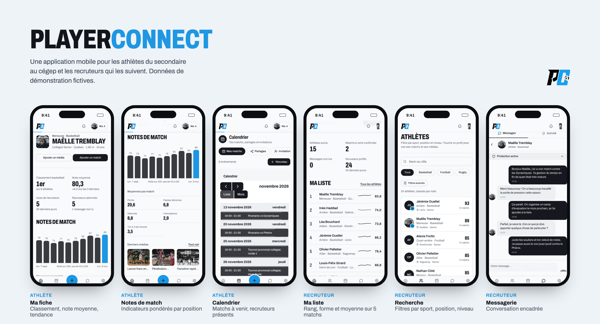
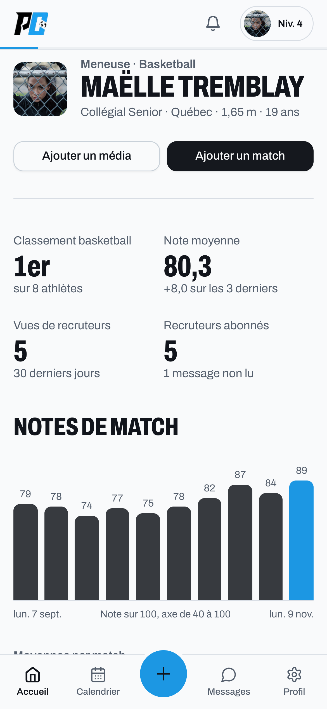
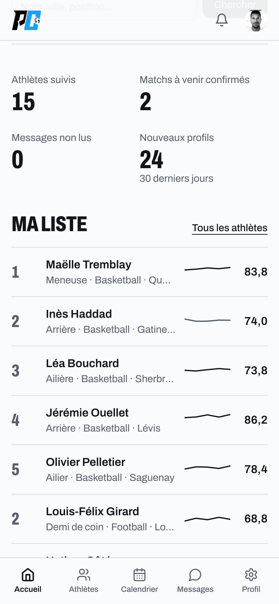
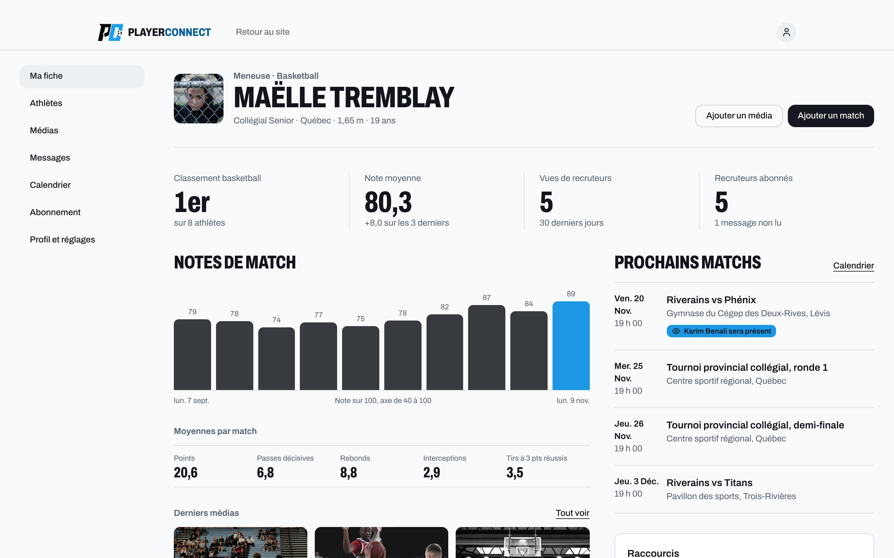

<p align="center">
  
</p>

<h1 align="center">PlayerConnect</h1>

<p align="center">
  Le profil sportif que les recruteurs consultent.<br/>
  Stats, vidéos et calendrier de match des athlètes du secondaire, du cégep et de l'université, au même endroit.
</p>

<p align="center">
  
</p>

## Le problème

Au Québec, un athlète de 16 ans qui vise le collégial ou l'universitaire envoie encore des vidéos YouTube et un PDF de stats par courriel. Les recruteurs reçoivent des formats différents, impossibles à comparer, et n'ont aucun moyen simple de savoir quand l'athlète joue. Et comme la majorité de ces athlètes sont mineurs, le contact direct pose de vraies questions d'encadrement.

PlayerConnect est une application web pensée d'abord pour le téléphone (PWA) qui règle ces trois points.

## Ce que fait l'application

**Pour l'athlète**

- Une fiche : position, niveau, mensurations, classement dans son sport, note moyenne et tendance sur les derniers matchs.
- Des notes de match calculées à partir d'indicateurs propres à chaque sport et pondérés selon la position (points et passes au basketball, duels gagnés au soccer, plaquages au rugby...).
- Une galerie de photos et vidéos avec les vues et réactions des recruteurs.
- Un calendrier de matchs partageable : un recruteur peut confirmer sa présence, en mode discret s'il le souhaite.

**Pour le recruteur**

- Une liste d'athlètes suivis avec rang, moyenne et courbe de forme sur 5 matchs.
- Une recherche filtrable par sport, position, niveau, catégorie et ville.
- Une fiche détaillée (évolution, indicateurs clés, historique des matchs) et une messagerie intégrée.

**Encadrement des mineurs**

- Un athlète de moins de 18 ans ne reçoit de messages que des recruteurs approuvés par un parent ou tuteur (`ApprovedContact`).
- Les messages sont analysés avant l'envoi : numéros de téléphone, courriels et demandes de coordonnées sont bloqués et journalisés (`lib/moderation.ts`, `ModerationLog`).

## Captures

| Athlète | Recruteur |
| --- | --- |
|  |  |



## Stack

| Couche | Choix |
| --- | --- |
| Framework | Next.js 15 (App Router, Server Components), React 19, TypeScript |
| Données | PostgreSQL, Prisma 6 |
| Authentification | Better Auth (courriel et mot de passe, Google OAuth), rôles athlète et recruteur |
| UI | Tailwind CSS, Radix UI (shadcn/ui), FullCalendar, Recharts |
| Temps réel et médias | Pusher, Supabase Storage |
| Paiements | Stripe (abonnements) |
| Application | PWA installable, service worker hors ligne |

## Lancer le projet en local avec les données de démo

Prérequis : Node 20+, pnpm 9, une base PostgreSQL locale.

```sh
pnpm install

# Base locale vierge
createdb playerconnect_demo
export DATABASE_URL="postgresql://postgres@localhost:5432/playerconnect_demo"
export DIRECT_URL="$DATABASE_URL"
export BETTER_AUTH_SECRET="$(openssl rand -base64 32)"
export NEXT_PUBLIC_APP_URL="http://localhost:3000"

pnpm db:push    # crée le schéma
pnpm db:demo    # 24 athlètes, 5 recruteurs, matchs, médias, messages (fictifs)
pnpm dev
```

`pnpm db:demo` refuse de tourner si `DATABASE_URL` ne pointe pas vers `localhost` ou si le nom de la base ne se termine pas par `_demo`. Les comptes de démo :

| Rôle | Courriel | Mot de passe |
| --- | --- | --- |
| Athlète | `athlete@demo.playerconnect.local` | `demo-playerconnect` |
| Recruteur | `recruteur@demo.playerconnect.local` | `demo-playerconnect` |

Les autres variables (Stripe, Pusher, Supabase, Resend, Google) sont décrites dans `.env.example`. Pour parcourir la démo, des valeurs factices suffisent : l'envoi de médias, le temps réel et le paiement sont alors inactifs.

Les noms d'athlètes, d'équipes et d'établissements des données de démo sont fictifs. Les photos viennent d'Unsplash.

## Organisation du code

```
app/                    Routes (App Router) : site public, auth, espaces athlète et recruteur, API
components/dashboard/   Écrans des tableaux de bord (fiche athlète, vue recruteur, calendrier)
components/sections/    Sections de la page d'accueil
lib/                    Auth, accès base, classement, gamification, modération
prisma/                 Schéma, migrations, données de démo (demo-seed.mjs)
```

## Scripts utiles

| Commande | Rôle |
| --- | --- |
| `pnpm dev` | Serveur de développement |
| `pnpm build` | Build de production, sans accès à la base |
| `pnpm db:deploy` | Applique les migrations sur la base visée par `DATABASE_URL` (étape de déploiement séparée) |
| `pnpm lint` | ESLint |
| `pnpm db:demo` | Recharge les données de démo (base locale uniquement) |
| `pnpm db:studio` | Explorer la base avec Prisma Studio |

## Auteur

Conçu et développé par [Jean-Luc Gouaho](https://github.com/cortex225).
